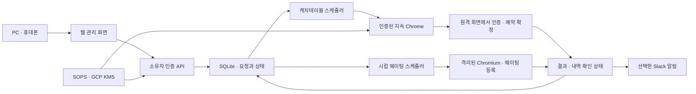

# OpenRun

OpenRun은 **가고 싶은 식당과 방문 일정을 등록해두면 예약·웨이팅 접수 시각에 서버가 실행하는 개인용 서비스**입니다. 캐치테이블과 시럽프렌즈 등 업체별 접수 방식을 하나의 웹 화면, 일정 저장소, 알림 흐름으로 묶습니다.

서비스는 항상 켜져 있는 원격 머신에서 실행합니다. PC·휴대폰은 신청 관리와 필요한 인증을 담당하고, 실행 시각에 사용자의 로컬 PC가 켜져 있을 필요는 없습니다.

## 전체 흐름

1. 웹에서 매장, 방문 날짜·인원, 예약 또는 웨이팅 조건을 입력합니다.
2. 서비스가 업체별 접수 시각을 한국 시간으로 계산하고 요청을 저장합니다.
3. 스케줄러가 해당 업체의 실행기를 호출합니다.
4. 실행기는 인증·입력·접수를 수행하거나 같은 서버 브라우저를 사용자에게 넘깁니다.
5. 결과와 확인이 필요한 상태를 웹 화면에 기록하고, 신청에서 선택한 경우 Slack으로 알립니다.



## 업체별 현재 기능

| 업체 | 신청 내용 | 현재 실행 범위 |
| --- | --- | --- |
| 캐치테이블 | 매장, 방문 날짜·시간·인원, 예약을 준비할 시각 | 로그인·세션 재사용 → 매장 페이지 준비 → 원격 화면 인계. 시간·인원 최종 선택과 예약 확정·결제는 사용자 진행 |
| 시럽프렌즈 · 나니요리 | 다음날 방문 날짜, 오전/오후, 인원, 연락처 | 지정 시각에 인원·전화번호 입력 → 확인 → 최종 제출 → 완료 화면의 대기 번호·앞 팀 수·등록 시간 수집 |

캐치테이블 초기 목록은 **모수 서울·노뜨르·베수비오**입니다. 나니요리는 별도의 **다음날 웨이팅** 화면에서 신청합니다. 나니요리 실행 흐름은 기존 [bots-on-lambda/syrupWaitingForNaniyori](https://github.com/yongseongkim/bots-on-lambda/tree/main/syrupWaitingForNaniyori)에서 이관했습니다.

나니요리 기본 접수 시각은 기존 운영 설정의 **10:00 / 16:00 KST**, 휴무 예정일은 **월·목**입니다. 현재 다음날 신청만 받으며, 같은 날짜·시간대의 활성 신청은 하나만 저장합니다. 이 값은 매장의 최신 접수 가능 여부를 보장하지 않으므로 운영 변경은 별도로 확인합니다.

## 시스템 구성

| 구성 요소 | 역할 |
| --- | --- |
| 웹 · API | 매장/예약/웨이팅 신청, 소유자 접근 권한, 요청 상태 조회 |
| SQLite | 캐치테이블 예약 준비와 시럽 웨이팅 요청의 영속 저장·중복 방지 |
| 업체별 스케줄러 | 접수 시각 판단, 실행 준비, 만료·중단·불확실한 결과 처리 |
| 캐치테이블 실행기 | 하나의 계정·지속 프로필을 직렬 사용하고 필요하면 noVNC로 사람에게 인계 |
| 시럽 실행기 | 로그인 없는 별도 브라우저 context에서 나니요리 접수. 최종 제출 직전 상태를 기록 |
| Slack | 사용자가 선택한 신청의 로그인 필요·예약 준비·웨이팅 실행 결과 알림 |
| SOPS · GCP KMS | 계정·관리 키·Webhook·캐치테이블 인증 스냅샷 암호화 |
| Docker Compose | 원격 머신의 단일 서비스, Chromium·Xvfb·x11vnc, 지속 데이터 볼륨 |

Node **26.13.0**, native TypeScript, Playwright를 사용합니다. 서비스 프로세스는 하나이고 DB는 로컬 SQLite입니다. 캐치테이블의 계정 프로필과 시럽의 임시 context는 분리합니다. 운영 DB·프로필·인증 상태는 Docker의 `openrun-data` 볼륨에 유지합니다.

웨이팅 전화번호는 SOPS에서 읽은 관리 키로 파생한 키를 사용해 AES-GCM으로 암호화합니다. 화면과 API에는 마스킹한 번호만 표시합니다. DB를 이관할 때 같은 관리 키도 필요합니다.

## 실행

Node/SOPS, Docker Compose, GCP KMS 접근을 준비한 뒤 실행합니다. 실제 비밀 파일은 공개 저장소에 포함하지 않습니다.

```sh
nvm install
nvm use
npm ci
npm run secrets:init
npm run secrets:edit
npm run remote:setup
docker compose up -d --build
npm run app:open
```

기존 SOPS 파일을 전달받았다면 `secrets:init`은 생략합니다. 관리 링크를 열고 **예약** 또는 **다음날 웨이팅**으로 이동합니다. 외부 PC·휴대폰 접속은 HTTPS 공개 주소가 필요하며, 설치·설정·이관 순서는 [원격 머신 실행 문서](docs/REMOTE_MACHINE.md)를 따릅니다.

## 상태와 실행 원칙

- 캐치테이블의 `READY`는 화면 준비, `COMPLETED`는 사용자의 내역 확인 완료입니다. 공급자가 확인한 예약 성공으로 해석하지 않습니다.
- 시럽의 `SUCCEEDED`는 완료 화면에서 대기 번호를 읽은 상태입니다. 최종 제출 후 결과를 잃으면 `UNKNOWN`으로 남기고 자동 재시도하지 않습니다.
- 신청 취소는 아직 실행하지 않은 서버 요청을 취소합니다. 이미 공급자에 등록된 예약·웨이팅을 취소하는 기능은 별도로 구현해야 합니다.
- CAPTCHA·추가 인증은 사람이 처리합니다. 실제 접수 조건·예약금·환불/노쇼 규정은 실행 전에 확인합니다.
- 서비스 정지·재시작·네트워크 지연이 있을 수 있어 접수 시각과 성공을 보장하지 않습니다. 여러 머신에서 같은 요청을 동시에 실행하지 않습니다.

## 개발과 문서

```sh
npm run browser:install
npm run check
npm test
```

테스트는 모의 업체 응답을 사용합니다. 실제 계정·전화 수신자·예약·결제·Slack을 대상으로 검증하지 않습니다. CI는 타입/단위 검사, 원격 브라우저 인계, 다음날 웨이팅 UI→접수 결과의 Docker 통합 테스트를 실행합니다.

- [개발 지침과 전체 구조](AGENTS.md)
- [캐치테이블 로그인·예약 준비](docs/CATCHTABLE.md)
- [나니요리 이관·다음날 웨이팅](docs/SYRUP_WAITING.md)
- [원격 실행·설정·상태 이관](docs/REMOTE_MACHINE.md)
- [구현 상태와 미정 작업 인계](docs/DEVELOPMENT_HANDOFF.md)

다음 확장 대상은 업체별 접수 조건·결과 검증을 공통 흐름에 추가하고, 명시적으로 승인한 조건 안에서 예약 자동화 범위를 넓히는 것입니다. 구체적인 진행 상황과 날짜가 정해진 테스트 계획은 인계 문서에 기록합니다.
