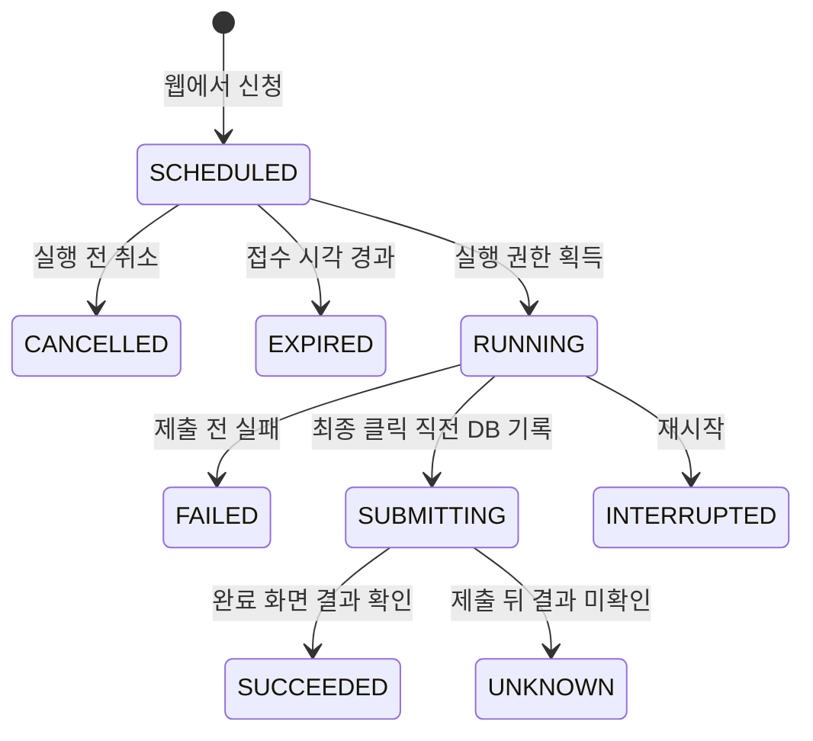

# 나니요리 시럽 웨이팅

## 이관 범위

원본은 [bots-on-lambda의 syrupWaitingForNaniyori/index.js](https://github.com/yongseongkim/bots-on-lambda/blob/e28c04b335a79451caa3096fea2b730c228839c4/syrupWaitingForNaniyori/index.js)입니다. 기존 저장소나 실제 AWS 배포는 변경하지 않았습니다.

인원 조절, 전화번호 입력, 다음 단계, 확인 화면, 최종 제출과 완료 화면 결과 추출을 `src/waiting/syrup.ts`로 이관했습니다. 기존 매장 링크와 `button.button-updown`, `#test_input`, `.button-next`, `.info-group-step3`, `wait_text-title`/`wait_text-point` 선택자를 사용합니다. Node 22/CommonJS/Lambda 런타임과 AWS SDK 의존성은 가져오지 않습니다.

| 원본 | OpenRun |
| --- | --- |
| SSM 전역 설정의 인원·전화번호와 활성화 플래그 | 날짜·시간대별 웹 신청, SQLite 저장 |
| EventBridge의 매일 반복 AM/PM 실행 | 신청한 다음날 해당 시간대 1회 실행 |
| `/waiting` Slack Slash Command로 전역 설정 변경 | `/waiting` 웹 페이지로 신청·실행 전 취소 |
| 멀티 탭 실패 시 전체 단일 탭 fallback | 입력 전 탐색만 최대 3회 방문. 최종 제출 이후 재시도 없음 |
| Slack 실패가 등록 실행 전체의 실패로 이어질 수 있음 | 접수와 알림 결과를 분리하여 재등록 방지 |
| SSM 평문 전화번호 | DB에서 AES-256-GCM 암호화, API는 마스킹 번호만 노출 |

기존 반복 플래그와 Slack Slash Command HTTP 수신 기능은 새 서비스에서 실행하지 않습니다. 웹에서 승인한 특정 날짜·시간대 요청만 실행하며 기존 SSM 설정도 자동으로 가져오지 않습니다.

## 다음날 신청

관리 링크로 로그인한 뒤 상단 **다음날 웨이팅**으로 이동합니다. URL은 `/waiting`입니다. 로그인하지 않은 방문자는 신청 내역을 읽거나 등록할 수 없습니다.

1. 서버가 한국 시간으로 계산한 다음날 날짜를 확인합니다.
2. 오전/오후, 인원과 연락처를 입력합니다.
3. 필요하면 Slack 결과 알림을 선택합니다. 기본값은 선택 해제입니다.
4. 실제 자동 웨이팅 등록에 동의한 뒤 **내일 웨이팅 신청**을 누릅니다.

기본 설정은 기존 봇의 **10:00 / 16:00 KST**, **월·목 휴무 예정**이며 `src/waiting/config.ts`에 있습니다. 인원 상한 8명은 이 서비스의 입력 제한이며 실제 매장의 인원 제한을 뜻하지 않습니다. 휴무 예정일에는 신청을 받지 않습니다. 다음날 이외의 날짜는 API에서도 거부합니다. 매장의 운영 변경을 확인한 경우 구성과 테스트를 함께 갱신합니다.

같은 매장·날짜·시간대의 활성 신청은 1건만 저장합니다. 인원·전화번호를 바꾸려면 실행 대기 중인 요청을 취소하고 새로 신청합니다. 오전과 오후는 각각 신청할 수 있습니다. 이미 제출 중이거나 결과가 불확실한 요청은 덮어쓰거나 자동 재실행하지 않습니다.

**신청 취소**는 아직 실행하지 않은 OpenRun 요청만 취소합니다. 시럽에 이미 등록된 웨이팅의 취소와는 다릅니다. 공급자 내역·취소 조건은 별도로 확인합니다.

## 실행과 상태

스케줄러는 실행 2분 전부터 별도 headless Chromium을 준비하고 지정 시각 이후 등록을 시작합니다. 캐치테이블의 로그인 프로필이나 noVNC 조작 탭은 사용하지 않습니다. 접수 창은 지정 시각부터 최대 2분입니다. 서버·네트워크·페이지 지연으로 정확한 시각이나 성공을 보장하지 않습니다.



`SUCCEEDED`에는 대기 번호·앞 팀 수·등록 시간이 있습니다. 최종 클릭 뒤 응답이나 결과 화면을 잃으면 `UNKNOWN`입니다. 타이머 tick이나 서버 재시작으로 다시 제출하지 않습니다. 접수 내역을 사람이 확인한 뒤 후속 처리를 결정합니다. 실행 중 재시작 시 `RUNNING`은 `INTERRUPTED`, `SUBMITTING`은 `UNKNOWN`으로 복구합니다.

접수 시간 밖의 페이지, CAPTCHA, 예상 밖의 origin, 변경된 화면에서는 중단합니다. CAPTCHA를 자동으로 풀거나 새로운 탭에서 제출 전체를 반복하지 않습니다. 현재 시럽의 사람 인계용 viewer는 구현하지 않았습니다.

## API와 연락처

기존 관리 쿠키 또는 관리 Bearer 토큰으로 인증합니다. 브라우저 쓰기 요청에는 같은 Origin과 JSON 본문이 필요합니다.

| 요청 | 역할 |
| --- | --- |
| `GET /api/app/waiting` | 서버 기준 다음날·휴무·시간대와 신청 내역 |
| `POST /api/app/waiting` | 다음날 실제 자동 접수를 명시적으로 신청 |
| `POST /api/app/waiting/:id/cancel` `{}` | 실행 전 신청 취소 |

POST 필드는 `restaurantId: "naniyori"`, `visitDate: "YYYY-MM-DD"`, `slot: "am" | "pm"`, `partySize`, `phoneNumber`, `confirmed: true`, 선택적인 `notify: boolean`입니다. 응답에는 원문 전화번호나 암호문이 없습니다. 서버에서 다음날·휴무·중복 여부를 다시 검증합니다.

`OPENRUN_ADMIN_TOKEN`에서 전화번호 암호화 키를 파생합니다. 요청마다 nonce를 생성하고 요청 ID를 authenticated data로 사용합니다. 연락처는 실행할 때 메모리에서 복호화하며 Slack에도 포함하지 않습니다. `waiting_jobs`에는 암호문과 마스킹한 번호가 저장됩니다.

관리 키를 바꾸면 이전 연락처를 복호화할 수 없으므로 DB와 같은 SOPS 설정을 함께 보존합니다. 키 회전·연락처 재암호화 도구는 아직 없습니다. DB만 옮기거나 관리 키를 새로 발급해 기존 신청을 실행하지 마세요.

## 운영 전환과 검증

기존 Lambda/EventBridge와 OpenRun이 같은 웨이팅을 실행하지 않도록 cutover를 계획합니다. 기존 AWS 스케줄 중지나 SSM 이관은 자동으로 수행하지 않았습니다. 이번 검증에서도 실제 웨이팅·문자·Slack 메시지를 만들지 않았습니다.

테스트는 암호화·마스킹, KST 자정, 휴무·중복 신청, 취소, 제출 경계, 불확실한 결과, 재시작, 알림 실패, Origin·CAPTCHA 중단을 검사합니다. 통합 테스트는 웹 신청 → 일정 실행 → 모의 시럽 접수 → 대기 번호 표시 → 새로고침 → 모바일 화면을 실제 Chromium으로 확인합니다.

```sh
npm run check
npm test
docker build -t openrun-remote:local .
docker run --rm --shm-size=1g \
  --mount "type=bind,source=$PWD/tests,target=/app/tests,readonly" \
  openrun-remote:local node tests/integration/waiting.e2e.ts
```

2026-11-04 KST에 공개 매장 링크가 접수 시간 밖 페이지로 연결되는 것을 확인했습니다. 실제 영업시간의 입력/확인 화면, 현재 인원 제한·추가 동의 여부, 실접수 성공률은 아직 검증하지 않았습니다. 원본 선택자에 맞춘 모의 응답으로 테스트했으며, 실운영 전에는 매장 조건과 사용자가 승인한 신청으로 검증해야 합니다.
