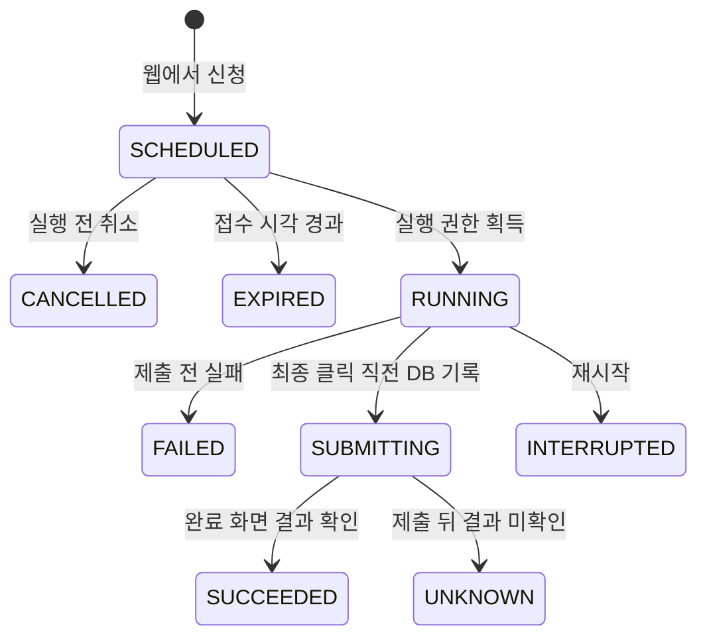

# 나니요리 시럽 웨이팅

## 이관 범위

원본은 [bots-on-lambda의 syrupWaitingForNaniyori/index.js](https://github.com/yongseongkim/bots-on-lambda/blob/e28c04b335a79451caa3096fea2b730c228839c4/syrupWaitingForNaniyori/index.js)입니다. 기존 저장소나 실제 AWS 배포는 변경하지 않았습니다.

인원 조절, 전화번호 입력, 다음 단계, 확인 화면, 최종 제출과 완료 화면 결과 추출을 `src/waiting/syrup.ts`로 이관했습니다. 기존 매장 링크와 `button.button-updown`, `#test_input`, `.button-next`, `.info-group-step3`, `wait_text-title`/`wait_text-point` 선택자를 사용합니다. Node 22/CommonJS/Lambda 런타임과 AWS SDK 의존성은 가져오지 않습니다.

| 원본 | OpenRun |
| --- | --- |
| SSM 전역 설정의 인원·전화번호와 활성화 플래그 | 다음 접수 명부의 인원수·전화번호, PostgreSQL 저장 |
| EventBridge의 매일 반복 AM/PM 실행 | 상시 서비스가 DB의 날짜·시간대별 신청을 해당 시각에 1회 실행 |
| `/waiting` Slack Slash Command로 전역 설정 변경 | `/waiting` 웹 페이지로 신청·실행 전 취소 |
| 멀티 탭 실패 시 전체 단일 탭 fallback | 입력 전 탐색만 최대 3회 방문. 최종 제출 이후 재시도 없음 |
| Slack 실패가 등록 실행 전체의 실패로 이어질 수 있음 | 접수와 알림 결과를 분리하여 재등록 방지 |
| SSM 평문 전화번호 | DB에서 AES-256-GCM 암호화, API는 마스킹 번호만 노출 |

기존 반복 플래그와 Slack Slash Command HTTP 수신 기능은 새 서비스에서 실행하지 않습니다. 웹에서 승인한 특정 날짜·시간대 요청만 실행하며 기존 SSM 설정도 자동으로 가져오지 않습니다.

## 다음 접수 명부

OCI k3s에서는 공용 PostgreSQL의 `openrun` DB에 연결해 시럽 전용 웹·스케줄러를 실행합니다. `DATABASE_URL`과 [DB 마이그레이션](POSTGRESQL.md)을 먼저 준비합니다. `compose.waiting.yaml`도 같은 저장 계층의 독립 실행 구성입니다. 캐치테이블 계정과 원격 데스크톱은 필요하지 않습니다. 설치·HTTPS·KMS 설정은 [원격 실행 문서](REMOTE_MACHINE.md#oci에서-나니요리만-실행)를 따릅니다.

`npm run waiting:open` 또는 컨테이너의 같은 명령으로 관리 링크를 발급한 뒤 **나의 웨이팅 열기**를 누릅니다. URL은 `/waiting`입니다. 링크를 여는 것만으로 인증 토큰을 소비하지 않습니다. 로그인하지 않은 방문자는 신청 내역을 읽거나 등록할 수 없습니다. 통합 모드의 기존 관리 쿠키도 사용할 수 있습니다.

1. 매장 설정에서 정한 **다음 접수 시간 한 번**을 확인합니다. 명부는 접수 전날 00:00 KST부터 작성할 수 있습니다.
2. 인원수·전화번호를 입력하고 **다음 접수에 신청**을 누릅니다. 버튼 옆 안내에 해당 시각의 실제 시럽 접수를 시도한다는 내용을 표시합니다.
3. **이번 접수 명부**에서 확인하고, 실행 전에는 **삭제**할 수 있습니다. 날짜·시간대 선택, 상태 배지, 이력, Slack 선택은 화면에 두지 않습니다.

기본 설정은 기존 봇의 **10:00 / 16:00 KST**, **월·목 휴무 예정**이며 `src/waiting/config.ts`에서 관리합니다. 매장 일정 변경은 이 설정에서 반영합니다. 한 번에 가장 가까운 접수 명부만 작성하며 먼 날짜나 이후 회차를 골라 미리 신청하지 않습니다. 오전이 지나면 오후, 하루 접수가 끝나면 다음 영업 예정일의 오전으로 바뀝니다. 접수 전날이 되지 않았다면 시간만 안내하고 신청은 비활성화합니다.

한 명부에 서로 다른 전화번호를 등록할 수 있고, 동일 전화번호의 중복 추가는 차단합니다. 인원·전화번호를 바꾸려면 명부에서 삭제하고 새로 추가합니다. 각 신청은 한 회차에만 사용하고 다음 회차로 복사하지 않습니다. 완료·불확실 결과·중단 등의 기록은 DB에 유지해 재접수를 막습니다.

**명부에서 삭제**는 아직 실행하지 않은 OpenRun 요청만 취소합니다. 시럽에 이미 등록된 웨이팅의 취소와는 다릅니다. 공급자 내역·취소 조건은 별도로 확인합니다.

## 실행과 상태

기존 Lambda 코드는 EventBridge가 2분 먼저 호출하면 Chromium을 띄우고 정각 1초 뒤까지 기다립니다. OpenRun은 같은 시각 정책을 상시 스케줄러에 적용합니다. cron이나 AWS 자격 증명이 없어도 DB에 저장한 다음 신청을 매초 확인합니다. 신청이 없는 날에는 브라우저나 시럽 페이지를 열지 않습니다.

| 시간대 | 브라우저 준비 | 접수 시도 시작 | 접수 창 종료 |
| --- | --- | --- | --- |
| 오전 | 09:58:00 | 10:00:01 | 10:02:00 |
| 오후 | 15:58:00 | 16:00:01 | 16:02:00 |

모든 시각은 방문일의 KST입니다. PostgreSQL `waiting_requests`에는 준비·시도·마감 시각을 `timestamptz`로 저장하고 API는 기존 `opensAt`, `prepareAt`, `runsAt`, `deadline` 밀리초 형식을 유지합니다. 브라우저는 준비 시각에 한 번 띄워 실행까지 유지하고, 실행 완료·실패 또는 준비 후 신청 취소 시 닫습니다. 인원·연락처 입력과 페이지 탐색은 시도 시각 이후에 시작합니다. 캐치테이블의 로그인 프로필이나 noVNC 조작 탭은 사용하지 않습니다. 서버·네트워크·페이지 지연으로 정확한 시각이나 성공을 보장하지 않습니다.



`SUCCEEDED`에는 대기 번호·앞 팀 수·등록 시간이 있습니다. 최종 클릭 뒤 응답이나 결과 화면을 잃으면 `UNKNOWN`입니다. 타이머 tick이나 서버 재시작으로 다시 제출하지 않습니다. 접수 내역을 사람이 확인한 뒤 후속 처리를 결정합니다. 실행 중 재시작 시 `RUNNING`은 `INTERRUPTED`, `SUBMITTING`은 `UNKNOWN`으로 복구합니다. 아직 실행하지 않은 미래의 `SCHEDULED`는 DB에 남아 다음 실행을 이어갑니다. 상태 변경과 `waiting_attempts` 이력은 같은 트랜잭션에 기록합니다. 전용 DB 세션의 실행권을 가진 서버만 복구·실행하고, 연결 상실 시 브라우저와 서비스를 중단합니다. 기존 SQLite는 로컬/통합 어댑터에 남으며 PostgreSQL로 자동 이관하지 않습니다.

접수 시간 밖의 페이지, CAPTCHA, 예상 밖의 origin, 변경된 화면에서는 중단합니다. CAPTCHA를 자동으로 풀거나 새로운 탭에서 제출 전체를 반복하지 않습니다. 현재 시럽의 사람 인계용 viewer는 구현하지 않았습니다.

## API와 연락처

기존 관리 쿠키 또는 관리 Bearer 토큰으로 인증합니다. 브라우저 쓰기 요청에는 같은 Origin과 JSON 본문이 필요합니다.

| 요청 | 역할 |
| --- | --- |
| `GET /api/app/waiting` | 서버 기준 다음 접수 시간·명부 작성 가능 여부와 신청 기록 |
| `POST /api/app/waiting` | 표시된 다음 접수 명부에 추가 |
| `POST /api/app/waiting/:id/cancel` `{}` | 실행 전 신청 취소 |

POST 필드는 `partySize`, `phoneNumber`, `openingId`, `confirmed: true`입니다. `openingId`는 GET의 `nextOpening.id`이며 사용자 입력이 아닙니다. 날짜·슬롯은 서버가 다음 접수로 결정합니다. 화면을 연 뒤 회차가 바뀌었거나 설정 변경으로 ID가 달라지면 `WAITING_OPENING_CHANGED`로 거부합니다. 전날 이전에는 `WAITING_REGISTRATION_NOT_OPEN`입니다. 원문 전화번호·암호문은 반환하지 않습니다. 웹은 결과 알림을 요청하지 않습니다. 기존 API의 명시적인 `notify: true`는 허용하되 해당 신청에만 적용합니다.

`OPENRUN_ADMIN_TOKEN`에서 전화번호 암호화 키를 파생합니다. 요청마다 nonce를 생성하고 요청 ID를 authenticated data로 사용합니다. 연락처는 실행할 때 메모리에서 복호화하며 Slack에도 포함하지 않습니다. `waiting_requests`에는 암호문과 마스킹한 번호가 저장됩니다.

관리 키를 바꾸면 이전 연락처를 복호화할 수 없으므로 DB와 같은 SOPS 설정 또는 Kubernetes Secret을 함께 보존합니다. 키 회전·연락처 재암호화 도구는 아직 없습니다. DB만 옮기거나 관리 키를 새로 발급해 기존 신청을 실행하지 마세요.

## 운영 전환과 검증

기존 Lambda/EventBridge와 OpenRun이 같은 웨이팅을 실행하지 않도록 cutover를 계획합니다. 기존 AWS 스케줄 중지나 SSM 이관은 자동으로 수행하지 않았습니다. 이번 검증에서도 실제 웨이팅·문자·Slack 메시지를 만들지 않았습니다.

테스트는 암호화·마스킹, KST 자정, 다음 회차·전날부터의 신청·휴무·전화번호 중복, 취소, 제출 경계, 불확실한 결과, 재시작, 알림 실패, Origin·CAPTCHA 중단을 검사합니다. 시럽 전용 서버는 캐치테이블 없이 시작·재시작하고 DB의 미래 신청을 이어 실행하는지 검사합니다. 통합 테스트는 관리 링크 → 두 입력 필드 → 서로 다른 번호의 명부 추가·삭제 → 중복 번호 거부 → 2분 전 준비 → 정각 미제출 → 1초 뒤 모의 접수·DB 결과 → 지난 회차 화면의 신청 거부 → 모바일 화면을 실제 Chromium으로 확인합니다.

```sh
npm run check
npm test
npm run test:postgres
docker build --target waiting -t openrun-waiting:test .
OPENRUN_POSTGRES_TEST_IMAGE=openrun-waiting:test npm run test:postgres
```

`waiting-daemon.e2e.ts`는 실제 `waiting:serve` 진입점을 시작해 HTTPS 공개 주소와 내부 CLI 접속 주소를 분리한 관리 링크 발급, 웹 API 신청, 서버 프로세스 재시작 후 DB 복원을 검사합니다. 임시 관리 키와 DB를 사용하고, 실행 시각이 아직 오지 않은 신청만 만들어 실제 시럽 접수는 하지 않습니다.

2026-11-04 KST에 공개 매장 링크가 접수 시간 밖 페이지로 연결되는 것을 확인했습니다. 실제 영업시간의 입력/확인 화면, 현재 인원 제한·추가 동의 여부, 실접수 성공률은 아직 검증하지 않았습니다. 원본 선택자에 맞춘 모의 응답으로 테스트했으며, 실운영 전에는 매장 조건과 사용자가 승인한 신청으로 검증해야 합니다.
